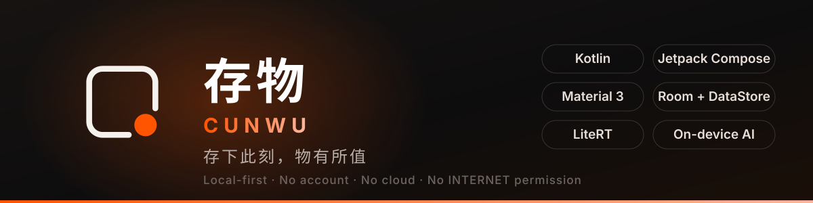
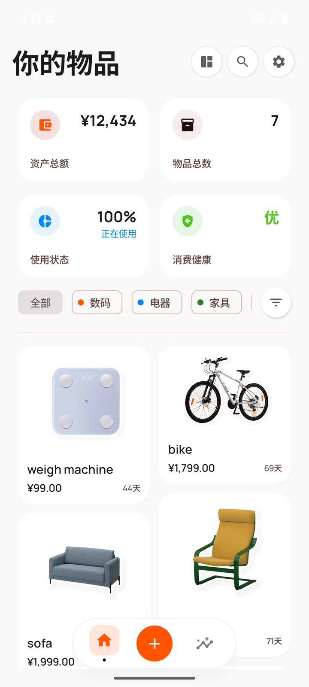
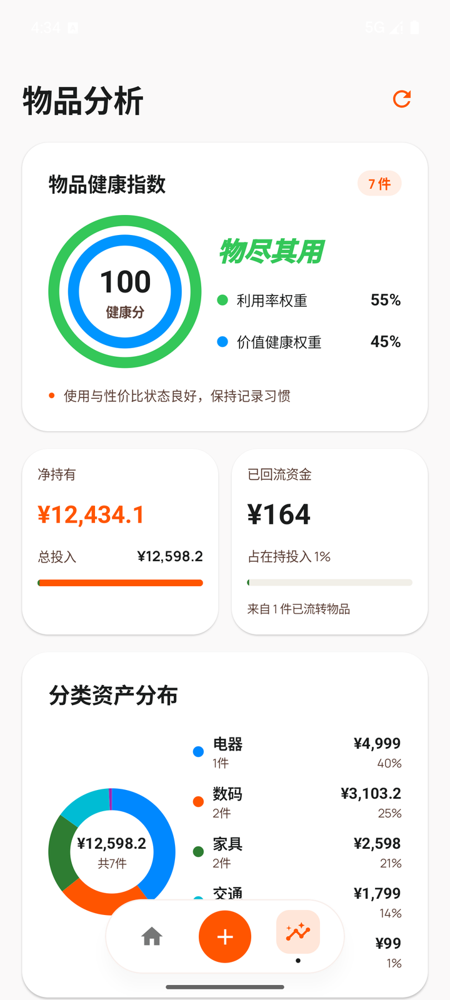
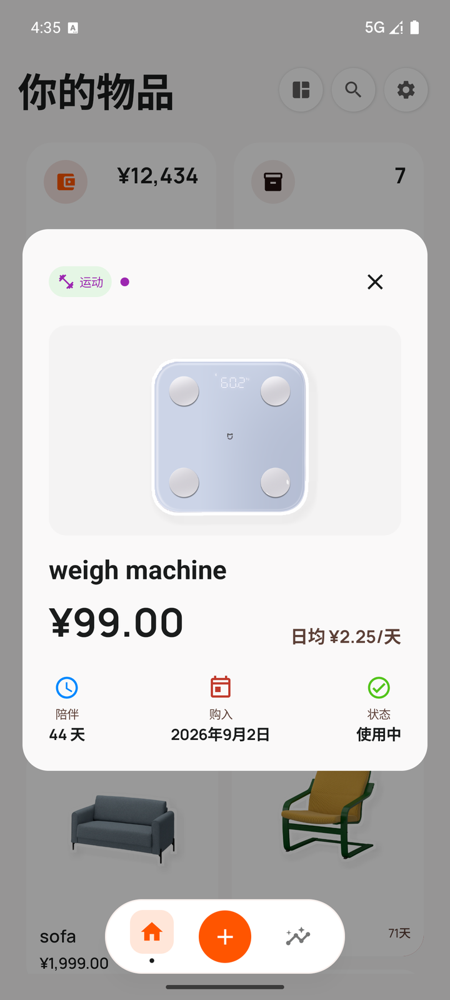
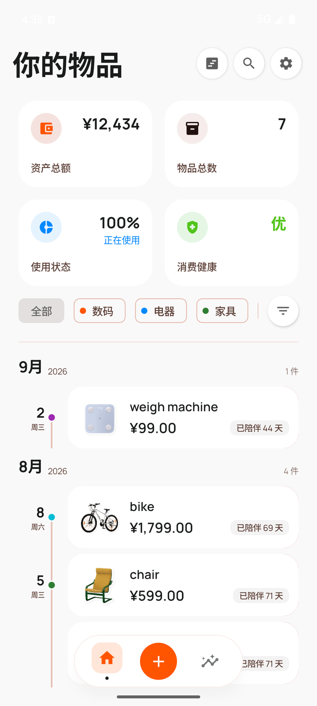
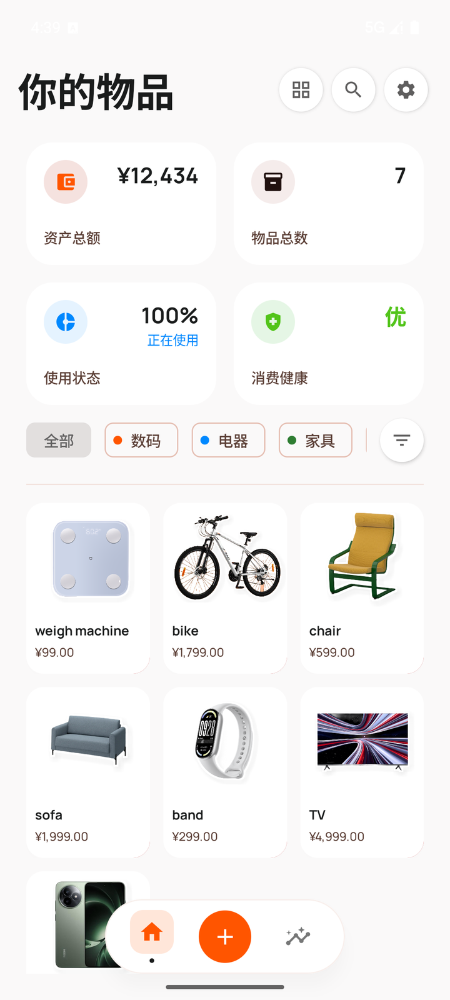
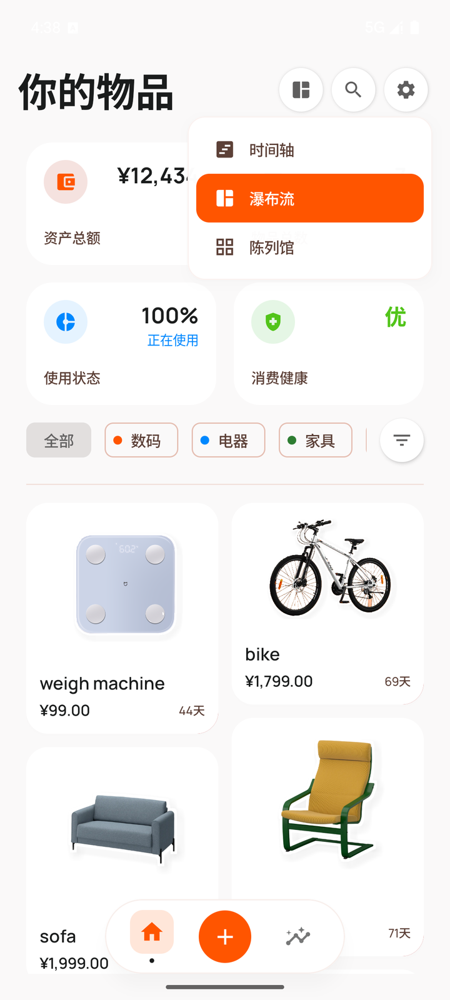
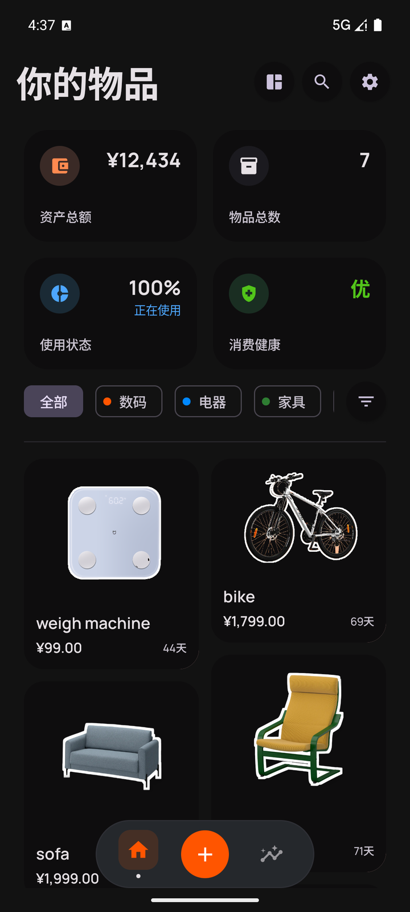
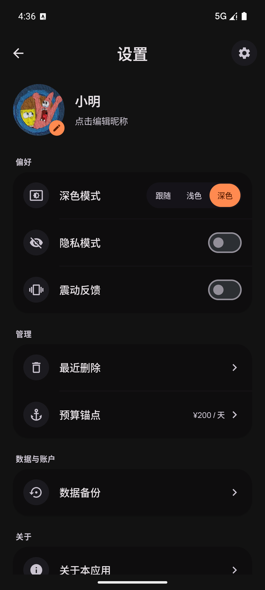
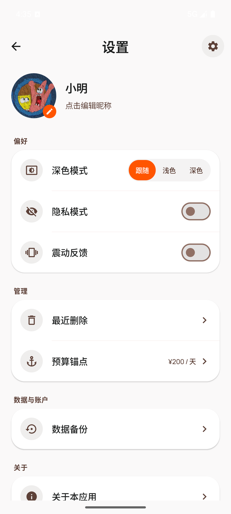

<div align="center">



# 存物 Cunwu

**存下此刻，物有所值**

本地物品管理 · 以健康分呈现物品的使用与性价比 · 辅助断舍离决策

[](https://kotlinlang.org)
[](https://developer.android.com/jetpack/compose)
[](https://m3.material.io)
[](https://developer.android.com/training/data-storage/room)
[](https://ai.google.dev/edge/litert)
[](https://gradle.org)
[](https://developer.android.com/build)
[](https://openjdk.org)
[](https://developer.android.com/about/versions/14)
[](https://developer.android.com/about/versions/16)
[](LICENSE)

[](https://developer.android.com)
[](docs/ARCHITECTURE.md)
[](#-隐私承诺)
[-FF5500?style=flat-square)](docs/BUILD.md#环境要求)

<br/>

## 📥 获取应用

<table>
<tr>
<td align="center" width="34%">
<a href="https://github.com/litiangu/cunwu-app/releases"><b>⬇️ 下载 APK</b></a><br/>
<sub>Releases · 需 Android 14+</sub>
</td>
<td align="center" width="33%">
<a href="docs/BUILD.md"><b>🔧 源码构建</b></a><br/>
<sub>需 JDK 21 + Git LFS</sub>
</td>
<td align="center" width="33%">
<a href="#-隐私承诺"><b>🔒 隐私承诺</b></a><br/>
<sub>无账号 · 无网络权限</sub>
</td>
</tr>
</table>

> 📦 下载 [Releases 页](https://github.com/litiangu/cunwu-app/releases) 的 `app-release.apk`，
> 或按[构建指南](docs/BUILD.md)从源码编译。
>
> ⚠️ APK 体积约 **179 MB**（release，已签名）/ **254 MB**（debug），
> 其中 ormbg 端侧模型独占 **168 MB**（占 release 的 94%）。首次下载请预留时间与磁盘空间。

</div>

---

---

## 📖 简介

### English Summary

**Cunwu** is a local-first Android app for cataloguing the things you own, built around one question: *is my stuff actually being used?*

Every item you record feeds a two-dimensional **Health Score**:

```
score = 0.55 × D1(利用率) + 0.45 × D2(价值健康度)
```

- **D1 Utilization** · in-use items ÷ owned items. Idle objects drag it down.
- **D2 Value Health** · your daily budget anchor ÷ the aggregate daily cost of holding everything. A coffee maker kept for six years is cheap per day; one replaced yearly is not.

Backgrounds are removed **fully on-device** with `ormbg` (an Apache-2.0 ISNet matting model) running on Google LiteRT. No account, no cloud, no `INTERNET` permission, no analytics. Your data never leaves the device.

### 中文简介

家里东西越买越多，却说不清哪些在用、哪些在吃灰。**存物** 让你把每件物品记下来，然后用一张**健康分**回答那个真正的问题：**这些钱花得值不值？**

健康分由两个维度构成：

| 维度 | 权重 | 含义 |
| :--- | :---: | :--- |
| **D1 利用率** | 55% | 使用中 ÷ 在持（已售出不计入分母）。闲置越多，分越低 |
| **D2 价值健康度** | 45% | `100 × min(1, 每日预算锚点 ÷ 聚合日均持有成本)`。陪伴越久，日均越低，分越高 |

拍下物品照片，App 会在**本机**用 `ormbg`（ISNet 架构，Apache-2.0）抠掉背景并做贴纸化处理，无需联网、无需上传。

所有数据只落在本机：没有账号，没有云端，`AndroidManifest.xml` 里**没有声明 `INTERNET` 权限**。这是一个可以从代码层面验证的承诺。

---

---

---

## 📸 界面预览

<table>
<tr>
<td align="center" width="33%"><b>首页 · 瀑布流</b><br><sub>资产概览 + 抠图贴纸</sub></td>
<td align="center" width="33%"><b>分析页</b><br><sub>健康分同心环 + 资产结构</sub></td>
<td align="center" width="33%"><b>物品详情</b><br><sub>日均成本 / 陪伴天数</sub></td>
</tr>
<tr>
<td align="center"></td>
<td align="center"></td>
<td align="center"></td>
</tr>
<tr>
<td align="center"><b>时间轴</b><br><sub>按购入月份分组</sub></td>
<td align="center"><b>陈列馆</b><br><sub>紧凑网格速览</sub></td>
<td align="center"><b>三视图切换</b><br><sub>一键切换布局</sub></td>
</tr>
<tr>
<td align="center"></td>
<td align="center"></td>
<td align="center"></td>
</tr>
<tr>
<td align="center"><b>深色模式 · 首页</b><br><sub>白边贴纸在黑底上轮廓清晰</sub></td>
<td align="center"><b>深色模式 · 设置</b><br><sub>自研双 ColorScheme</sub></td>
<td align="center"><b>设置页</b><br><sub>隐私 / 震动 / 预算</sub></td>
</tr>
<tr>
<td align="center"></td>
<td align="center"></td>
<td align="center"></td>
</tr>
</table>

> 📱 真机截图（Android 14，1080×2400），存于 `docs/screenshots/`。
> 数据为演示用测试数据，物品图片经端侧 ormbg 抠图处理。

---

---

## 🚀 三分钟上手

三个场景，看懂存物怎么用。

### 示例一 · 记一件东西，两步就好

<table>
<tr>
<td width="58%">

**1. 填信息**

点底部 ➕，选分类（数码 / 电器 / 家具 / 工具 / 运动 / 交通），填名称、
购入价格、购买日期，状态默认「使用中」。

**2. 拍照，背景自动抠掉**

在图片区拍一张或从相册选。App 在**本机**跑 ormbg 模型抠背景，
自动加白边和投影，负一屏也能看清轮廓。全程不联网。

</td>
<td align="center" width="42%">

<br/><sub>抠图成品 · 白边贴纸效果</sub>
</td>
</tr>
</table>

### 示例二 · 健康分告诉你哪件该扔

<table>
<tr>
<td width="58%">

健康分由两个维度决定：

- **利用率**（占 55%）= 使用中 ÷ 在持。闲置越多分越低
- **价值健康度**（占 45%）= 每日预算锚点 ÷ 日均持有成本。**用得久，日均越低，分越高**

打个比方：一件 1999 元的沙发用了 71 天，日均约 28 元。
预算锚点设 100 元/天，光这一件就拉高了整库的健康度。

分数分四档：**优 ≥ 85 / 良 ≥ 70 / 中 ≥ 50 / 差**。
首页和分析页同源同色，看到红色就该去翻排行榜了。

</td>
<td align="center" width="42%">

<br/><sub>同心多环 · 弧长即各维度得分占比</sub>
</td>
</tr>
</table>

### 示例三 · 三种视图，三种心情

<table>
<tr>
<td align="center" width="33%">

<br/><b>时间轴</b><br/><sub>按购入月份分组<br/>回忆「我什么时候买了什么」</sub>
</td>
<td align="center" width="34%">

<br/><b>陈列馆</b><br/><sub>紧凑圆图网格<br/>快速扫一眼持有全貌</sub>
</td>
<td align="center" width="33%">

<br/><b>深色模式</b><br/><sub>跟随系统 / 浅色 / 深色<br/>三档自由切换</sub>
</td>
</tr>
</table>

配合搜索框输入名称片段，或点筛选按钮按状态（使用中 / 未使用 / 已售出）
与排序（日期 / 金额，升 / 降）缩小范围。

---

## 🔒 隐私承诺

1. **数据本地化**。所有物品信息、图片、预算与偏好仅存于本机数据库与 DataStore，不上传任何服务器。
2. **无网络权限**。`AndroidManifest.xml` 未声明 `INTERNET`，应用在系统层面就无法联网。
3. **无第三方账号**。不要求注册，不与任何人共享数据。
4. **AI 推理在本机**。ormbg 模型随包分发，LiteRT 在设备 CPU 上运行，抠图过程零网络。
5. **数据自管**。备份由你自己创建、自己保管，卸载应用即彻底删除。

---

---


## 📄 许可证

本项目采用 [Apache License 2.0](LICENSE)。

```
Copyright 2026 存物 Cunwu

Licensed under the Apache License, Version 2.0 (the "License");
you may not use this file except in compliance with the License.
You may obtain a copy of the License at

    http://www.apache.org/licenses/LICENSE-2.0

Unless required by applicable law or agreed to in writing, software
distributed under the License is distributed on an "AS IS" BASIS,
WITHOUT WARRANTIES OR CONDITIONS OF ANY KIND, either express or implied.
See the License for the specific language governing permissions and
limitations under the License.
```

### 第三方组件

| 组件 | 来源 | 协议 |
| :--- | :--- | :--- |
| Kotlin | JetBrains | Apache-2.0 |
| Jetpack Compose（Material 3 / UI / Activity） | Google | Apache-2.0 |
| AndroidX Core KTX / Lifecycle / Room / DataStore | Google | Apache-2.0 |
| Material Icons | Google | Apache-2.0 |
| Navigation Compose | Google | Apache-2.0 |
| LiteRT | Google | Apache-2.0 |
| kotlinx.serialization | JetBrains | Apache-2.0 |
| **ormbg**（ISNet 抠图模型） | schirrmacher / litert-community | **Apache-2.0** |

> 选择 ormbg 而非 RMBG-1.4 的原因很直接：RMBG-1.4 是**非商业许可**，开源项目无法合法分发；ormbg 是完全开放的 Apache-2.0 权重，是它的可商用替代方案。

---

## 📄 说明与免责声明

本应用按「原样」提供，用于物品记录与健康分参考，**不构成任何专业财务或法律建议**。健康分是对你记录数据的一种加权呈现，模型的合理性取决于你录入的信息是否准确。

---

## 📚 延伸阅读

| 文档 | 内容 |
| :--- | :--- |
| [核心特性](docs/FEATURES.md) | 完整功能清单：健康分引擎、抠图流水线、三视图、分析页组件 |
| [构建指南](docs/BUILD.md) | 环境要求、7 步源码构建、常见构建问题 |
| [架构与技术](docs/ARCHITECTURE.md) | 目录结构、技术栈选型、路线图 |
| [发布流程](docs/RELEASE.md) | release 签名、体积优化（254 → 179 MB）、GitHub Releases 发布 |
| [贡献指南](CONTRIBUTING.md) | 分支策略、提交规范、R8 注意事项、领域踩坑约定 |

---

<div align="center">

**存下此刻，物有所值**

[](LICENSE)
[](https://kotlinlang.org)
[](#-隐私承诺)

</div>
